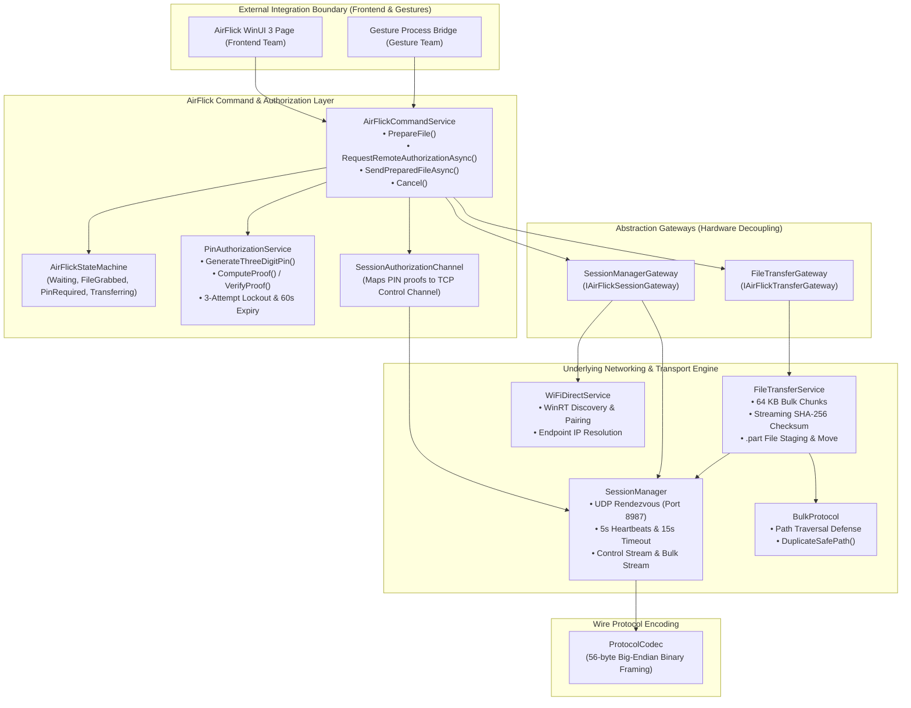
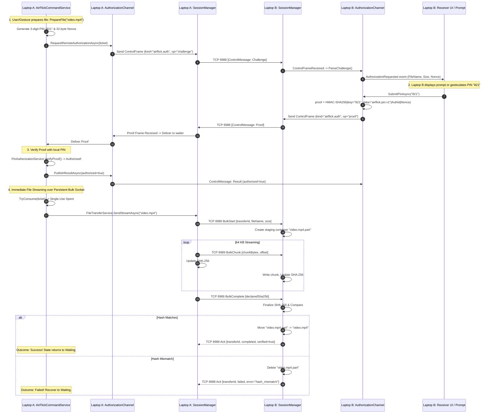

# AirFlick Rebuild Audit — 03: Backend Architecture

## 1. Architectural Principles of the Cleaned AirFlick Backend

1. **Hardware & UI Independence**: The core AirFlick backend (`AirFlickCommandService`, `AirFlickStateMachine`, `PinAuthorizationService`) does not take dependencies on WinUI 3, XAML, or physical hardware. Gateways abstract session and file streaming.
2. **Deterministic Lifecycle**: Centralized initialization and teardown controlled by `ServiceManager`. Sockets, background worker loops, and event handlers are strictly disposed when a session drops.
3. **Dual-Channel Multiplexing**: Sockets are separated into a low-latency **Control Channel** (JSON metadata, commands, PIN verification) and a high-bandwidth **Bulk Channel** (chunked file streams).
4. **Zero-Knowledge Consent Barrier**: The 3-digit PIN never traverses the network in plaintext. Senders issue a cryptographically random 32-byte nonce, and receivers submit an HMAC-SHA256 proof.

---

## 2. AirFlick Backend Architecture Diagram

---

## 3. End-to-End File Transfer Sequence

---

## 4. State Machine Reconciled States

`AirFlickStateMachine` manages high-level application states independently of low-level socket connections:
- `Starting`: Initialization.
- `Discovering`: Scanning for nearby laptops.
- `DeviceFound`: Peer discovered.
- `Connecting`: Wi-Fi Direct association in progress.
- `SessionReady`: TCP channels established and heartbeats running.
- `Waiting`: Idle, ready to grab a file.
- `FileGrabbed`: File selected and staged for authorization.
- `PinRequired`: Challenge issued; awaiting peer proof.
- `PinVerified`: Proof validated; ready to stream.
- `Transferring`: File transmitting over Bulk channel.
- `TransferComplete`: Transmission and receiver hash verification finished.
- `Failed`: Error occurred (recovers back to `Waiting` if connection is healthy).

