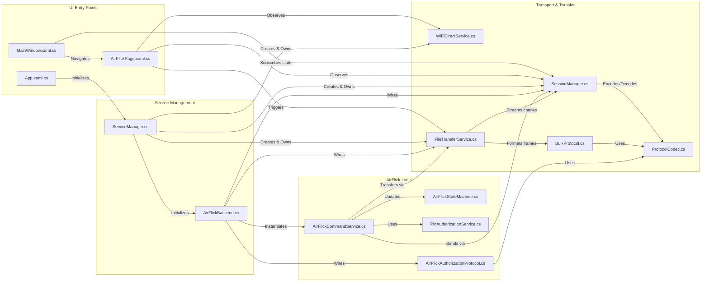

# AirFlick Rebuild Audit — 04: Dependency and Call Graph

## 1. Upstream and Downstream Call Graph

The following matrix documents the exact caller/callee relationships across the repository, tracing what calls each major component and what each component depends upon.

---

## 2. Detailed File Dependency Matrix

### A. AirFlick Subsystem
| Component | Direct Upstream Callers | Direct Downstream Dependencies | Integration Risk if Changed |
| :--- | :--- | :--- | :--- |
| `AirFlickCommandService.cs` | `AirFlickBackend.cs`, `AirFlickCommandServiceTests.cs` | `IAirFlickSessionGateway`, `IAirFlickTransferGateway`, `IPinAuthorizationService`, `AirFlickStateMachine` | **LOW (High isolation)**. Relies entirely on interfaces. Changes do not leak into networking or UI. |
| `AirFlickBackend.cs` | `ServiceManager.cs` | `WiFiDirectService`, `SessionManager`, `FileTransferService`, `AirFlickCommandService`, `AirFlickAuthorizationProtocol` | **MEDIUM**. Central adapter. Changes affect how `SessionManager` routes `airflick.auth` frames. |
| `AirFlickStateMachine.cs` | `AirFlickCommandService.cs`, `AirFlickPage.xaml.cs`, `AirFlickStateMachineTests.cs` | Pure C# (no external dependencies) | **LOW**. Self-contained state transitions. |
| `PinAuthorizationService.cs` | `AirFlickCommandService.cs`, `PinAuthorizationServiceTests.cs` | `System.Security.Cryptography.HMACSHA256`, `RandomNumberGenerator` | **LOW**. Pure cryptography and ticket accounting. |
| `AirFlickAuthorizationProtocol.cs` | `AirFlickBackend.cs`, `AirFlickAuthorizationProtocolTests.cs` | `ProtocolFrame`, `ProtocolChannel`, `System.Text.Json` | **LOW**. Reuses `ProtocolFrameType.ControlMessage`. |

### B. Networking & Transfer Subsystem
| Component | Direct Upstream Callers | Direct Downstream Dependencies | Integration Risk if Changed |
| :--- | :--- | :--- | :--- |
| `WiFiDirectService.cs` | `ServiceManager.cs`, `ConnectionPage.xaml.cs`, `AirFlickPage.xaml.cs` | `Windows.Devices.WiFiDirect`, `Windows.Devices.Enumeration` | **HIGH**. Direct WinRT P2P hardware dependency. Must be preserved carefully. |
| `SessionManager.cs` | `ServiceManager.cs`, `FileTransferService.cs`, `AirFlickBackend.cs`, `MainWindow.xaml.cs` | `System.Net.Sockets.TcpClient`, `UdpClient`, `ProtocolCodec`, `SessionStateMachine` | **HIGH**. Manages all active network sockets and heartbeats. |
| `FileTransferService.cs` | `ServiceManager.cs`, `AirFlickBackend.cs`, `FileTransferPage.xaml.cs` | `SessionManager`, `BulkProtocol`, `System.Security.Cryptography.SHA256` | **HIGH**. Core chunk streaming and destination disk write safety. |
| `ProtocolCodec.cs` | `SessionManager.cs`, `FileTransferService.cs`, `ProtocolCodecTests.cs` | `System.Buffers.Binary`, `ProtocolFrame` | **CRITICAL**. Modifying the 56-byte header breaks wire protocol compatibility. |

### C. Unrelated Modules Scheduled for Decoupling
| Component | Direct Upstream Callers | Downstream Dependencies to Sever | Decoupling Strategy |
| :--- | :--- | :--- | :--- |
| `AudioService.cs` | `ServiceManager.cs`, `AudioPage.xaml.cs` | `NAudio.Wasapi`, `OpusSharp`, `SessionManager` | Remove call from `ServiceManager.InitializeAdditionalServices()`, remove `AudioPage`, remove NuGet packages. |
| `ChatService.cs` | `ServiceManager.cs`, `ChatPage.xaml.cs` | `SessionManager`, `ChatProtocol` | Remove from `ServiceManager`, remove `ChatPage`. |
| `SpeedTestService.cs` | `ServiceManager.cs`, `SpeedTestPage.xaml.cs` | `SessionManager`, `BulkProtocol` | Remove from `ServiceManager`, remove `SpeedTestPage`. |

