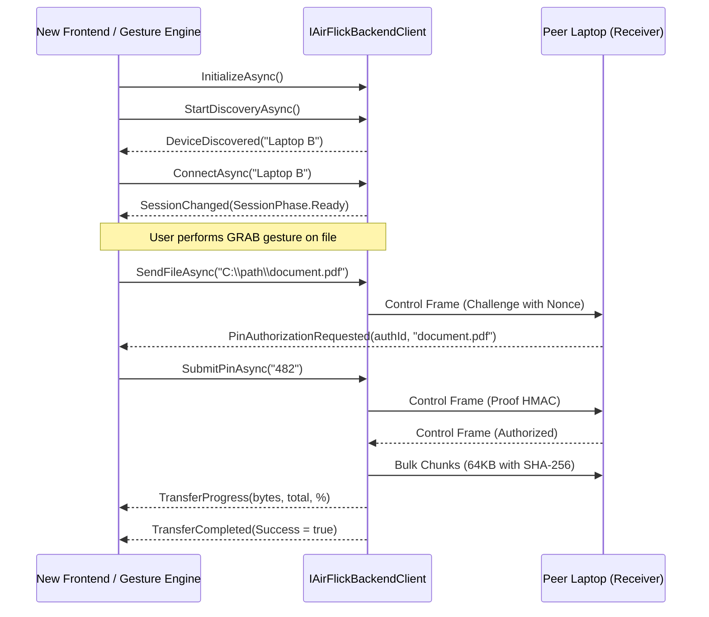

# AirFlick — Backend API Contract

This document specifies the public integration surface for connecting a future frontend (e.g. WinUI 3, WPF, MAUI, or webview) or a gesture-recognition service to the AirFlick backend.

---

## 1. Interface: `IAirFlickBackendClient`

Defined in [`Services/IAirFlickBackendClient.cs`](file:///e:/PROJECT/AirFlick/Services/IAirFlickBackendClient.cs).

### Properties
- `AirFlickState State`: Current high-level AirFlick workflow state (`Starting`, `Discovering`, `DeviceFound`, `Connecting`, `SessionReady`, `Waiting`, `FileGrabbed`, `PinRequired`, `PinVerified`, `Transferring`, `TransferComplete`, `Failed`).
- `SessionPhase SessionPhase`: Transport session state (`Disconnected`, `WifiDirectConnected`, `ConnectingTransport`, `Handshaking`, `Ready`, `Degraded`, `Disconnecting`, `Failed`).
- `bool IsConnected`: True if a P2P session is ready and operational.
- `string? PeerName`: The friendly display name of the connected peer laptop.
- `IReadOnlyList<string> DiscoveredDevices`: List of nearby peer devices discovered during scanning.

### Events
- `event EventHandler<AirFlickStateChangedEventArgs>? StateChanged`: Fires when high-level workflow state changes.
- `event EventHandler<AirFlickSessionChangedEventArgs>? SessionChanged`: Fires when the low-level Wi-Fi Direct session status changes.
- `event EventHandler<string>? DeviceDiscovered`: Fires as each new peer device is found.
- `event EventHandler<AirFlickTransferProgressEventArgs>? TransferProgress`: Reports real-time transfer progress (bytes transferred, total bytes, percentage).
- `event EventHandler<AirFlickTransferResultEventArgs>? TransferCompleted`: Fires upon completion or failure of a file transfer.
- `event EventHandler<AirFlickPinChallengeEventArgs>? PinAuthorizationRequested`: Receiver-side notification when a sender requests authorization with a PIN challenge.

### Methods
- `Task InitializeAsync()`: Initializes Wi-Fi Direct drivers, networking services, and registers internal event pipelines.
- `Task ShutdownAsync()`: Disconnects active sessions and releases hardware adapters.
- `Task StartDiscoveryAsync()`: Starts scanning for nearby AirFlick peers.
- `Task StopDiscoveryAsync()`: Stops scanning.
- `Task<bool> ConnectAsync(string deviceName)`: Establishes a Wi-Fi Direct connection and handshakes with the target peer.
- `Task DisconnectAsync()`: Gracefully tears down active Wi-Fi Direct session.
- `Task<AirFlickTransferOutcome> SendFileAsync(string filePath, CancellationToken cancellationToken = default)`: Prepares and sends a file across the bulk transfer channel.
- `Task<bool> SubmitPinAsync(string pin)`: Receiver-side method to submit the user-entered PIN to compute proof and authorize transfer.

---

## 2. Typical Workflow Integration Sequence

