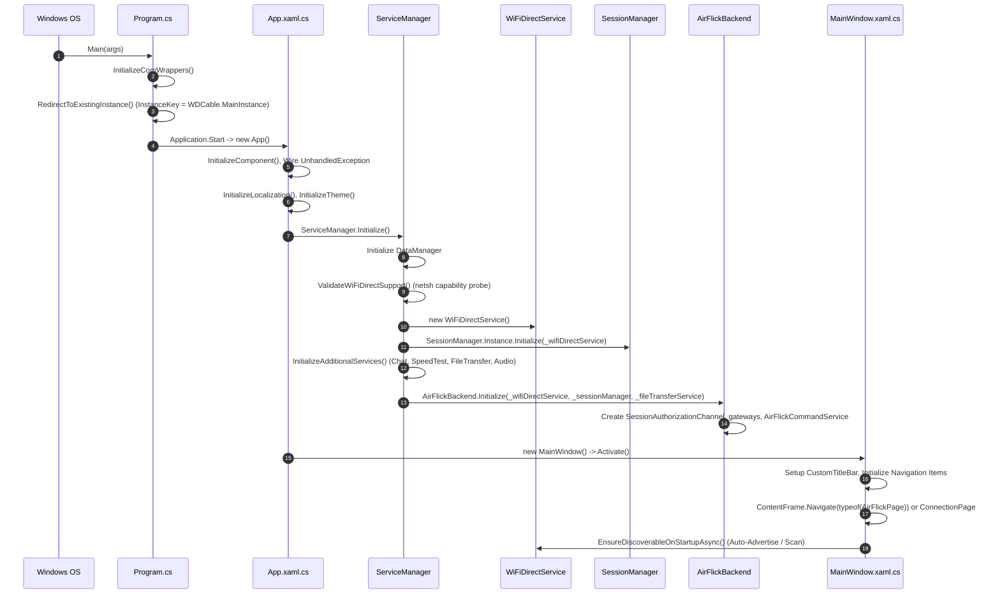
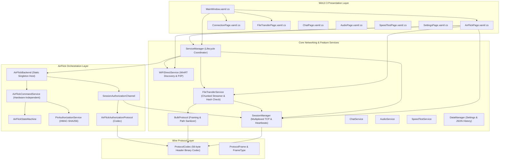

# AirFlick Architecture Audit — C# Application Architecture

## 1. Application Lifecycle & Startup Sequence

---

## 2. Component Boundaries and Dependency Map

---

## 3. Service Lifecycles, Scope, and Singletons

- **`ServiceManager`**: Global static class. Controls the startup and teardown of all communication singletons via `SemaphoreSlim LifecycleSemaphore = new(1, 1)`.
- **`WiFiDirectService`**: Created once during `ServiceManager.Initialize()`. Owns the native WinRT `WiFiDirectAdvertisementPublisher` and `WiFiDirectWatcher`.
- **`SessionManager`**: Pure singleton accessed via `SessionManager.Instance`. Owns the TCP sockets (Rendezvous UDP 8987, Control TCP 8988, Bulk TCP 8989). Connections are maintained across multiple transfers until explicitly torn down.
- **`AirFlickBackend`**: Static wrapper created inside `ServiceManager.InitializeAdditionalServices()`. Bridges `SessionManager` and `FileTransferService` to `AirFlickCommandService`.
- **`AirFlickCommandService`**: Long-lived instance owned by `AirFlickBackend`. Does not depend on any WinUI page being active.

---

## 4. Teardown and Cleanup Paths

When the application closes or Wi-Fi Direct resets:
1. `MainWindow.xaml.cs` traps the `AppWindow.Closing` event.
2. `ServiceManager.DisposeFeatureServices()` is invoked:
   - Resets `AirFlickBackend` (which calls `AirFlickCommandService.Dispose()`, cancelling pending transfers and unregistering control frame handlers).
   - Resets `ChatService`, `SpeedTestService`, `FileTransferService`, and `AudioService`.
3. `ServiceManager.DisposeWiFiDirectServices()`:
   - Unsubscribes `SessionManager.PeerProtocolMissing`.
   - Calls `SessionManager.ResetInstance()`, terminating TCP listeners and active client sockets.
   - Calls `WiFiDirectService.Dispose()`, stopping advertisements, stopping watchers, and releasing paired device references.

