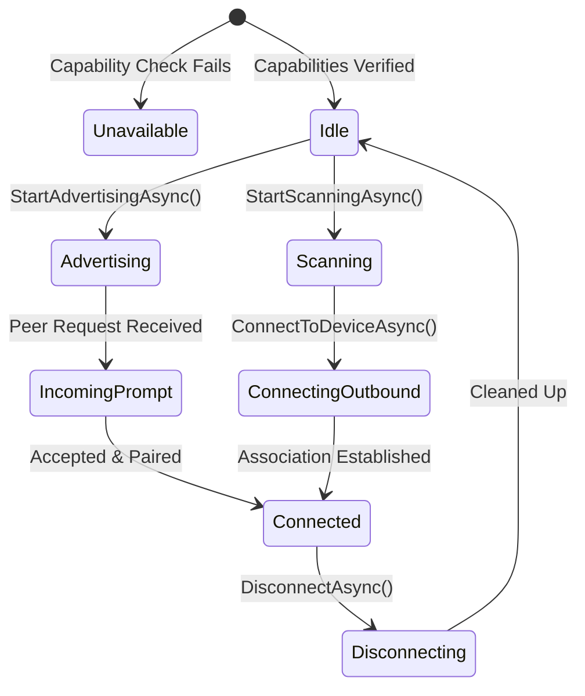
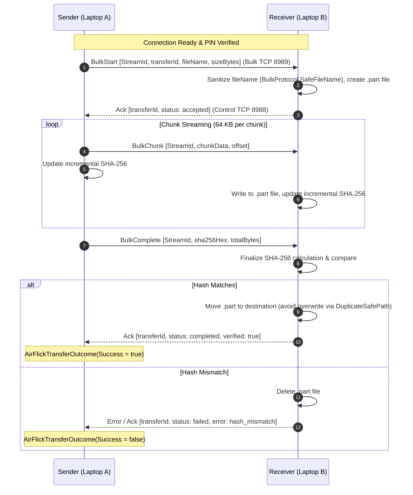

# AirFlick Architecture Audit — Networking, Wi-Fi Direct, and File Transfer

## 1. Wi-Fi Direct Architecture and Lifecycle

AirFlick utilizes native Windows Runtime Wi-Fi Direct APIs (`Windows.Devices.WiFiDirect`) implemented in `WiFiDirectService.cs` (1,530 lines).



### Key Networking Details:
- **Pre-flight Hardware Capability Probe**: `ServiceManager.cs` executes `netsh.exe wlan show wirelesscapabilities` and checks for:
  - `Wi-Fi Direct Device: Supported`
  - `Wi-Fi Direct GO: Supported`
  - `Wi-Fi Direct Client: Supported`
  - `P2P Device Discovery: Supported`
- **Role Assignment**: Dynamic. When devices associate, `WiFiDirectEndpointSelector.cs` selects the IP pair (`LocalIP`, `RemoteIP`) and determines:
  - The side with lower IPv4 byte-order becomes **Group Owner (GO)**.
  - The other side becomes **Client**.
  - Transport roles: Group Owner acts as Connector (or listener depending on phase); Client binds as Listener.
- **Rendezvous Phase**: Handled over UDP port `8987` via `SessionRendezvousPayload.cs`. Exchanged metadata includes session ID, rendezvous ID, and port definitions.

---

## 2. Multiplexed TCP Transport Architecture

Once Wi-Fi Direct is established, `SessionManager.cs` establishes two dedicated TCP stream connections:
1. **Control Channel (`TCP 8988`)**:
   - Transports control messages: `HandshakeHello`, `HandshakeAck`, `HeartbeatPing`, `HeartbeatPong`, `ChatControlMessage`, and `AirFlickAuthorizationProtocol` frames (`airflick.auth`).
   - Regular heartbeats sent every 5 seconds; 15-second heartbeat timeout triggers session teardown.
2. **Bulk Channel (`TCP 8989`)**:
   - Dedicated exclusively to heavy streaming payloads: `BulkStart`, `BulkChunk` (64 KB chunks), `BulkComplete`, and `BulkCancel`.

### Binary Frame Wire Format (`ProtocolCodec.cs`)
Each frame begins with a fixed 56-byte header in Big-Endian format:
```
+------------------------------------------------------------+
| Magic (4 bytes): 0x57444342 ("WDCB")                       |
| Version (2 bytes): 0x0002                                  |
| HeaderSize (2 bytes): 0x0038 (56 bytes)                    |
| FrameType (2 bytes): e.g. 10 (Control), 20 (BulkStart), etc.|
| Flags (2 bytes): Bit flags                                 |
| Channel (2 bytes): 1 (Control), 2 (Bulk), 3 (Audio)        |
| Reserved (2 bytes): 0x0000                                 |
| StreamId (8 bytes): Unique stream identifier               |
| SequenceNumber (8 bytes): Monotonically increasing seq     |
| CorrelationId (16 bytes): GUID correlation identifier      |
| MetadataLength (4 bytes): JSON string byte count           |
| PayloadLength (4 bytes): Binary data byte count            |
+------------------------------------------------------------+
| JSON Metadata (Variable: MetadataLength bytes)             |
+------------------------------------------------------------+
| Binary Payload (Variable: PayloadLength bytes)             |
+------------------------------------------------------------+
```

---

## 3. Bulk File Transfer Protocol Lifecycle

The file transfer lifecycle in `FileTransferService.cs` guarantees end-to-end receipt and verification:



### Critical Transfer Guarantees:
1. **True Verification vs Socket Flush**: `FileTransferService.SendFilePathAsync` does **not** return success when bytes are sent; it awaits a confirmation `Ack` containing the receiver's verification verdict.
2. **Directory & Path Traversal Prevention**: `BulkProtocol.SafeFileName` strips absolute directories, rejects parent directory traversal (`..`, `.`), replaces reserved Windows characters (`:`), and escapes DOS device names (`CON`, `PRN`, `AUX`, `NUL`, `COM1..9`, `LPT1..9`).
3. **Session Persistence**: File transfers do **not** close the TCP sockets or disconnect Wi-Fi Direct. Once a transfer completes or fails, the state transitions back to `Waiting` (`AirFlickStateMachine`), maintaining the active session for subsequent file transfers.

