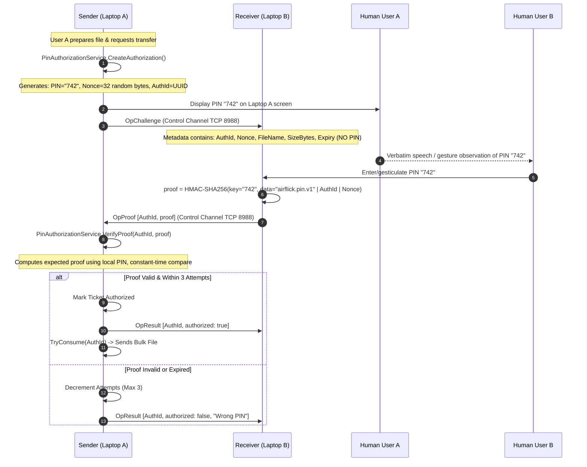

# AirFlick Architecture Audit — PIN Authorization and Security

## 1. PIN Authorization Protocol Architecture

AirFlick incorporates a zero-knowledge proximity PIN authorization gate implemented in `PinAuthorizationService.cs` and `AirFlickAuthorizationProtocol.cs`.

---

## 2. Answers to Specific Security Questions

1. **Who generates the PIN?**
   - **Laptop A (The Sender)** generates the PIN via `PinAuthorizationService.GenerateThreeDigitPin()`.
2. **Who enters the PIN?**
   - **Laptop B (The Receiver)** enters the PIN (or gesticulates it in future phases).
3. **What data is used in the proof?**
   - Proof is derived as:
     $$\text{proof} = \text{HMAC-SHA256}\Big(\text{key} = \text{UTF8}(\text{PIN}),\; \text{data} = \text{"airflick.pin.v1"} \,\|\, \text{AuthId} \,\|\, \text{Nonce}\Big)$$
4. **How is the proof transmitted?**
   - Via `AirFlickAuthorizationProtocol.CreateProofFrame()` over the TCP Control Channel (`ProtocolChannel.Control`, `ProtocolFrameType.ControlMessage`).
5. **Which device verifies the proof?**
   - **Laptop A (The Sender)** verifies the proof using `CryptographicOperations.FixedTimeEquals`.
6. **How does the verifying device communicate success or failure?**
   - Via `OpResult` control message containing `authorized: true/false` and an optional message string.
7. **At exactly what point is receiver-side authorization granted?**
   - In `AirFlickCommandService.SendPreparedFileAsync()` (Sender), transfer proceeds immediately upon verifying the proof. The receiver acts upon receiving the verified `BulkStart`.
8. **Can a receiver grant authorization before proof verification finishes?**
   - **No.** The sender will not stream the file if proof verification does not return `Authorized`.
9. **How are attempts limited?**
   - Enforced by `PinAuthorizationService`: `DefaultMaxAttempts = 3`. Each incorrect proof decrements the ticket's remaining attempts until status becomes `TooManyAttempts`.
10. **How does expiry work?**
    - Tickets have `DefaultLifetime = 60 seconds`. Requests evaluated after `ticket.ExpiresAtUtc` return `PinAuthorizationStatus.Expired`.
11. **Are proofs or authorization IDs single-use?**
    - **Yes.** `PinAuthorizationService.TryConsume(authorizationId)` sets `entry.Consumed = true` and returns `true` exactly once. Any second call returns `false`.
12. **Can an authorization be replayed?**
    - **No.** Each ticket includes a cryptographically random 32-byte `Nonce` (`RandomNumberGenerator.GetBytes(32)`), guaranteeing that proofs are unique per session and challenge.
13. **Is authorization tied to the active session?**
    - In `AirFlickBackend.SessionAuthorizationChannel`, any session state change to `Disconnected`, `Disconnecting`, or `Failed` clears all incoming and pending authorizations (`FailPending(...)`).
14. **Are unauthorized BulkStart messages rejected before any destination file is created?**
    - In standard `FileTransferService`, any incoming `BulkStart` creates a `.part` staging file. If incoming transfers are made outside `AirFlickBackend` without pre-authorization, the base `FileTransferService` accepts standard file transfers. The authorization barrier currently lives in the sender command orchestrator (`AirFlickCommandService`).
    - *Security recommendation*: Receiver-side file creation should explicitly validate against incoming authorization records before creating `.part` files.

---

## 3. Cryptographic Strength vs. Proximity Consent

> [!WARNING]
> A 3-digit PIN has only $10^3 = 1,000$ possible combinations. 
> While online brute-force guessing is prevented by the 3-attempt lockout, **an active eavesdropper capturing the non-secret `Nonce`, `AuthId`, and `proof` over the network can compute HMAC-SHA256 across all 1,000 values in milliseconds offline**.
> Therefore, this protocol acts as a **human proximity and consent gate**, not an impenetrable cryptographic barrier against determined wireless network eavesdroppers.

